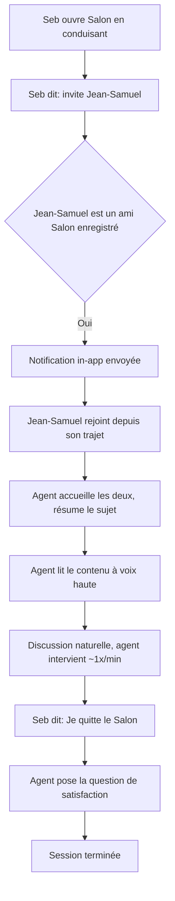
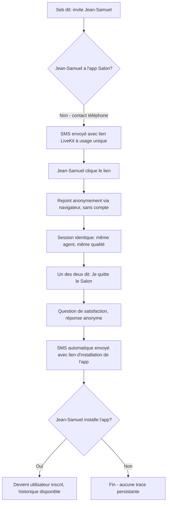

# UX Design Specification salon

**Author:** BMad
**Date:** 2026-07-28

---

<!-- UX design content will be appended sequentially through collaborative workflow steps -->

## Executive Summary

### Project Vision

Salon MVP est une application mobile voice-first qui permet à deux personnes de discuter en temps réel d'un document ou d'une actualité, animée par un agent vocal xAI — conçue pour transformer le trajet quotidien en voiture en moment d'apprentissage social.

### Target Users

Seb (ingénieur logiciel) et Jean-Samuel (ingénieur électrique féru de LLM) — des cols blancs techniques qui alternent entre hôte et invité, sur leur trajet, mains occupées au volant.

### Key Design Challenges

- Un paradigme quasi 100% vocal — l'interface visuelle doit rester minimale par conception (invitation, jonction, question de satisfaction), sans jamais devenir une béquille visuelle qui contredit le voice-first
- Deux expériences d'entrée radicalement différentes à concilier : l'utilisateur avec l'app native (amis enregistrés, contacts) vs. l'invité web anonyme sans compte (Journey 2)
- Le mécanisme de traduction simultanée (micro coupé pendant la lecture de la traduction) doit être imperceptible ou du moins non-déroutant pour l'utilisateur

### Design Opportunities

- Le minimalisme voice-first est lui-même un différenciateur — soigner la sensation de "zéro écran nécessaire en conduisant"
- Le moment de jonction anonyme (Journey 2) est un moment de conversion critique — première impression déterminante pour transformer un invité en utilisateur inscrit
- La question de satisfaction déclenchée par la commande de sortie peut devenir un rituel de clôture agréable plutôt qu'une simple formalité

## Core User Experience

### Defining Experience

Démarrer ou rejoindre une session de discussion vocale — l'agent détecte automatiquement la langue parlée par chaque participant, sans configuration manuelle.

### Platform Strategy

Application mobile native (iOS/Android) pour le MVP, usage principal mains-libres en conduisant. Aucun mode hors ligne (service temps réel). Extension future vers tablette et web pour les invités sur ordinateur.

### Effortless Interactions

- L'agent est **toujours à l'écoute** et comprend le langage naturel — aucun mot-clé de réveil requis pour inviter quelqu'un ou interagir
- Détection automatique de la langue parlée, sans étape de sélection
- Invitation par simple mention du nom d'un ami ou contact, sans manipulation de liens

### Critical Success Moments

**Premier lancement :** L'utilisateur crée un compte avec un numéro de téléphone vérifié (OTP) — friction minimale, filtre anti-abus léger. Aucune carte de crédit requise à ce stade. La méthode de paiement (Stripe) n'est demandée que lorsque l'heure d'essai gratuite à vie est épuisée, au moment où l'hôte a déjà vécu la valeur du produit.

**Premier "aha" :** La première fois qu'un utilisateur dit simplement "invite [nom]" et voit/entend que ça fonctionne sans autre manipulation.

### Experience Principles

- **Zéro configuration** — l'agent s'adapte à l'utilisateur (langue, contact), jamais l'inverse
- **La voix comme seule interface** — l'écran n'intervient que pour les moments qui l'exigent structurellement (paiement, invitation initiale)
- **Friction minimale et différée** — seule la vérification téléphone est requise à l'inscription ; le paiement n'apparaît qu'au moment où la valeur a déjà été prouvée (heure gratuite épuisée)
- **L'invité ne doit jamais sentir de barrière** — accès anonyme, gratuit, sans installation pour quiconque est invité

## Desired Emotional Response

### Primary Emotional Goals

Une **connexion sociale amplifiée** — l'utilisateur doit se sentir plus proche de son ami grâce à une conversation enrichie par l'IA, jamais remplacée par elle. L'IA est un catalyseur de lien humain, pas le centre de l'expérience.

### Emotional Journey Mapping

- **Découverte :** curiosité — "est-ce que ça va vraiment marcher ?"
- **Onboarding (vérification téléphone) :** confiance, rapidité — aucune friction perçue
- **Pendant la session :** fluidité et connexion — l'agent en retrait, jamais au premier plan de l'attention
- **Fin de session (question de satisfaction) :** fierté et accomplissement — "j'ai appris quelque chose de concret avec mon ami"
- **Retour (2ᵉ, 3ᵉ usage) :** anticipation confiante — "quel sera le sujet la prochaine fois ?"

### Micro-Emotions

- **Confiance** plutôt que méfiance, dès la vérification téléphone
- **Fluidité** plutôt que frustration, malgré un agent toujours à l'écoute
- **Connexion** plutôt qu'isolement, même avec une IA dans la boucle
- **Accomplissement** plutôt qu'indifférence, à la clôture de chaque session

### Design Implications

- L'agent intervient avec parcimonie — par défaut, une intervention succincte par minute lorsque les participants partagent la même langue ; plus présent seulement lorsqu'il traduit activement entre deux langues différentes (rôle d'interprète, pas de bavard)
- Les participants peuvent ajuster cette fréquence vocalement à tout moment ("parle moins souvent", "interviens plus"), donnant à chacun le contrôle du rythme
- Le ton vocal de l'agent reste en retrait et soutenant, jamais dominant ou performatif
- La vérification téléphone (OTP) doit être la plus courte possible, sans questions superflues
- Le moment de plus-value (traduction, contraste, connaissance nouvelle) doit se ressentir comme un cadeau partagé entre les deux amis, pas comme une démonstration de l'IA

### Emotional Design Principles

- **L'IA amplifie la connexion humaine, elle ne la remplace jamais**
- **La discrétion de l'agent est une fonctionnalité, pas un compromis** — mesurable (1 intervention/minute par défaut) et ajustable par la voix
- **Chaque session doit laisser une trace de valeur tangible** — compréhension nouvelle, traduction fluide, ou lien renforcé

## UX Pattern Analysis & Inspiration

### Inspiring Products Analysis

**Gemini dans Android Auto :**
- Résout élégamment le problème d'assistance mains-libres en conduisant, avec une distraction visuelle minimale
- Onboarding : déjà intégré au système, aucune configuration séparée
- Navigation : voice-first, UI glanceable (cartes simples, gros caractères), pensée pour la sécurité routière
- Interaction délicieuse : toujours à l'écoute (mot de réveil "Hey Google"), conversation naturelle, réponses rapides
- Gestion d'erreur : "je n'ai pas compris, peux-tu répéter ?" — récupération gracieuse sans frustration

**WhatsApp :**
- Résout élégamment la messagerie/appels rapides avec ses contacts
- Onboarding : **numéro de téléphone uniquement, aucun courriel/mot de passe** — friction minimale dès l'inscription
- Navigation : la liste de contacts EST l'interface principale — un tap suffit pour démarrer un appel
- Interaction délicieuse : démarrage d'appel vocal/vidéo instantané depuis un contact, indicateurs de confiance (chiffrement)

### Transferable UX Patterns

**Patterns d'Onboarding :**
- L'inscription par numéro de téléphone seul (WhatsApp) — valide directement l'approche déjà retenue pour Salon (FR17)

**Patterns d'Interaction :**
- "Taper un contact pour appeler" (WhatsApp) devient, en voice-first, "dire le nom d'un contact pour inviter" — l'équivalent vocal exact du même geste
- Toujours à l'écoute sans mot-clé de réveil (au-delà même de Gemini) — pousse l'idée d'Android Auto encore plus loin, cohérent avec FR10

**Patterns Visuels :**
- UI glanceable, gros caractères, cartes simples (Android Auto) — pertinent pour les rares écrans de Salon (confirmation d'invitation, question de satisfaction affichée)

### Anti-Patterns to Avoid

- **La liste de conversations comme interface principale (WhatsApp)** — Salon ne doit jamais devenir une app de clavardage textuel ; la voix reste primaire, l'historique doit rester léger ("avec qui j'ai discuté", pas un fil de messages à faire défiler)
- **Frustration de reconnaissance vocale ratée (Android Auto)** — la détection de langue et la compréhension doivent être robustes, avec une récupération polie en cas d'incompréhension plutôt qu'un silence ou une erreur brute
- **Surcharger l'écran de menus de navigation façon app classique en conduisant** — contredit directement le principe voice-first

### Design Inspiration Strategy

**À Adopter :**
- Inscription par numéro de téléphone seul (WhatsApp) — déjà notre approche (FR17), validée par un produit que Seb et Jean-Samuel utilisent quotidiennement
- UI glanceable et minimale pour les rares écrans (Android Auto) — gros caractères, une seule action évidente par écran

**À Adapter :**
- "Contact tapable" (WhatsApp) devient "nom prononçable" — même mental model, medium différent (voix plutôt que tap)

**À Éviter :**
- Toute tentation de construire un historique de discussion textuel façon WhatsApp — l'historique de Salon reste au niveau des sessions et partenaires, pas des messages

## Design System Foundation

### 1.1 Design System Choice

Système établi : React Native Paper (implémentation Material Design 3 pour React Native) — un seul codebase Expo pour iOS/Android, sans design system custom.

### Rationale for Selection

L'UI de Salon est volontairement minimale (vérification téléphone, confirmation d'invitation, question de satisfaction, historique léger). La différenciation du produit vient de la voix, pas du visuel — investir dans un design system custom serait un mauvais usage du temps limité d'un solopreneur. Un système établi apporte accessibilité intégrée et rapidité de développement.

### Implementation Approach

React Native via Expo, avec React Native Paper pour les composants Material 3 — un seul codebase TypeScript pour iOS et Android, déployé via Expo Application Services (EAS Build/Submit).

### Customization Strategy

Personnalisation minimale : accent de couleur de marque et typographie seulement. Aucune bibliothèque de composants custom nécessaire vu le nombre restreint d'écrans.

## 2. Core User Experience

### 2.1 Defining Experience

**"Dire un nom, démarrer une conversation intelligente."** — Comme Tinder ("swipe pour matcher") ou Spotify ("découvrir et jouer n'importe quelle chanson"), Salon se résume à un geste : nommer un ami à voix haute pour lancer une discussion vocale animée par l'IA.

### 2.2 User Mental Model

Seb et Jean-Samuel connaissent déjà deux modèles mentaux que Salon fusionne : "taper un contact pour appeler" (WhatsApp) et "parler à un assistant vocal" (Gemini/Alexa). Salon retire même l'étape du mot-clé de réveil — plus proche encore d'une conversation naturelle entre humains que d'une commande à un assistant.

### 2.3 Success Criteria

- L'agent comprend le nom mentionné sans avoir besoin de répétition ou de reformulation
- L'invité rejoint et l'agent commence à faciliter en quelques secondes, aussi rapide qu'un appel téléphonique classique
- Aucune étape intermédiaire (pas de menu, pas de confirmation à taper) entre l'intention et l'action

### 2.4 Novel UX Patterns

Combine des patterns établis (appel par contact, assistant vocal) d'une façon inédite : l'agent vocal n'est pas un outil ponctuel de question-réponse, mais un **partenaire conversationnel continu** qui reste présent tout au long de l'échange entre deux humains — un rôle qui n'existe dans aucun produit grand public actuel.

### 2.5 Experience Mechanics

**1. Initiation :** L'hôte dit simplement "invite [nom]" à voix haute, à tout moment — l'app est toujours à l'écoute, aucun mot-clé de réveil requis.

**2. Interaction :** Le système résout le nom vers un ami Salon (notification in-app) ou un contact téléphone (SMS), sans que l'hôte ait à manipuler quoi que ce soit d'autre.

**3. Feedback :** L'agent confirme vocalement ("Invitation envoyée à Jean-Samuel") et annonce quand l'invité rejoint la session.

**4. Completion :** La session démarre — l'agent commence à lire et animer la discussion, sans étape supplémentaire.

**Note de localisation :** L'affichage visuel de l'application (les quelques écrans existants) se présente dans la langue vocale détectée de l'utilisateur, jamais dans une langue fixe (voir FR13). Les mockups de ce document sont illustrés en français à titre représentatif seulement.

## Design Direction Decision

### Design Directions Explored

Étant donné le nombre très restreint d'écrans de Salon (vérification téléphone, confirmation d'invitation, session en cours, question de satisfaction vocale, jonction anonyme), une exploration de 6-8 variations abstraites de layout n'était pas pertinente. À la place, un mockup HTML unique montrant les 5 écrans réels a été généré et itéré directement : [`ux-design-directions.html`](ux-design-directions.html).

### Chosen Direction

**"Salon Parisien"** — palette bourgogne profond, accent or/laiton, fond beige ivoire chaud, typographie serif classique pour les titres. Logo rond représentant une causeuse classique à 3 places, agrandi et centré en haut de chaque écran. Icône de vérification téléphone stylisée en manipulateur télégraphique (clé Morse) du 19ᵉ siècle plutôt qu'un combiné téléphonique, pour renforcer l'ancrage historique. L'écran de question de satisfaction est strictement vocal — aucun bouton, cohérent avec le principe voice-first.

### Design Rationale

Cette direction fait écho directement au nom "Salon" — les salons littéraires français d'avant la Révolution, lieux de conversation raffinée — tout en restant fonctionnellement minimale et voice-first. Chaque élément visuel (causeuse, télégraphe) renforce la métaphore de conversation intime et intelligente plutôt que d'ajouter de la décoration superflue.

### Implementation Approach

Les mockups servent de référence directe pour l'implémentation React Native (React Native Paper / Material Design 3) avec les tokens de couleur définis dans la Fondation Visuelle. Le logo et l'icône télégraphe sont fournis en SVG dans le mockup, réutilisables tels quels comme assets vectoriels (via `react-native-svg`).

## User Journey Flows

### Journey 1 : Le Trajet du Matin (Chemin Heureux)

### Journey 2 : L'Invité Sans l'Application (Cas Limite)

### Journey Patterns

**Patterns de Navigation :**
- Toute action critique s'initie par une phrase naturelle dite à voix haute — jamais par un menu ou un tap
- La sortie de session suit toujours le même pattern verbal ("Je quitte le Salon") peu importe le parcours (app ou web anonyme)

**Patterns de Décision :**
- La résolution "ami Salon vs contact téléphone" est invisible pour l'hôte — le système choisit automatiquement le bon canal de livraison (notification vs SMS)
- La question de satisfaction est posée identiquement, authentifié ou non

**Patterns de Feedback :**
- Confirmation vocale immédiate après chaque action clé (invitation envoyée, invité rejoint, session terminée)
- Aucune confirmation visuelle requise pour valider une action — la voix suffit
- L'invité anonyme reçoit systématiquement un SMS de suivi avec lien d'installation après sa première session, sans action requise de sa part pour le déclencher

### Flow Optimization Principles

- **Zéro étape superflue** entre l'intention ("invite X") et l'action (invitation envoyée) — pas de confirmation à taper, pas de menu de canal à choisir
- **Symétrie des parcours** — l'expérience de session elle-même (lecture, discussion, sortie, satisfaction) est identique que l'invité ait l'app ou non, seule l'entrée diffère
- **Récupération gracieuse** — si l'agent ne comprend pas un nom mentionné, il redemande poliment plutôt que d'échouer silencieusement (cohérent avec la NFR Integration déjà établie)
- **Conversion différée mais automatique** — la conversion de l'invité anonyme vers utilisateur inscrit ne dépend pas d'une décision prise pendant la session, elle est proposée après coup par SMS

## Component Strategy

### Design System Components

Utilisés tels quels depuis React Native Paper (Material Design 3) : champ de texte (numéro de téléphone), bouton primaire plein, bouton secondaire à contour, typographie standard.

### Custom Components

#### Indicateur d'Onde Vocale (Voice Waveform)

**Purpose :** Signaler visuellement que l'agent écoute ou parle, sans texte nécessaire.
**Usage :** Écran de session en cours, écran de question de satisfaction.
**Anatomy :** 6 barres verticales animées, couleur or, hauteur variable.
**States :** écoute (pulsation lente), traduction active (pulsation plus rapide), silencieux (barres immobiles basses).
**Variants :** aucune — taille unique.
**Accessibility :** accompagné d'un label ARIA "L'agent écoute" / "L'agent parle" pour les lecteurs d'écran, puisque l'indicateur est purement visuel.
**Content Guidelines :** jamais de texte à l'intérieur, l'animation seule porte le sens.
**Interaction Behavior :** aucune interaction directe — purement informatif.

#### Badge Logo Causeuse

**Purpose :** Ancrage de marque en haut de chaque écran.
**Usage :** Tous les écrans, position fixe en haut centré.
**Anatomy :** Cercle bourgogne foncé, contour or, silhouette de causeuse à 3 places en ligne dorée.
**States :** statique uniquement.
**Variants :** une seule taille (grande, définie en étape 8).
**Accessibility :** alt text "Salon".

#### Bandeau de Confirmation

**Purpose :** Confirmer une action vocale accomplie (ex : "Invitation envoyée à Jean-Samuel").
**Usage :** Après une invitation, avant que l'invité rejoigne.
**Anatomy :** Bouton à contour or, texte centré, sans action tapable (affichage seul).
**States :** en attente ("En attente de Jean-Samuel…"), confirmé (invité a rejoint).
**Accessibility :** annoncé vocalement par l'agent en parallèle, jamais uniquement visuel.

#### Badge "Sans Installation"

**Purpose :** Rassurer l'invité anonyme qu'aucune friction ne l'attend.
**Usage :** Écran de jonction web anonyme uniquement.
**Anatomy :** Pilule or, texte court en majuscules.
**Accessibility :** contraste vérifié (texte bourgogne foncé sur or).

### Component Implementation Strategy

Composants custom construits directement avec les tokens de couleur/typographie de la Fondation Visuelle, au-dessus des composants natifs standards. Aucune bibliothèque de composants tierce nécessaire vu le nombre restreint (4 composants custom, tous simples).

### Implementation Roadmap

**Phase 1 — Composants critiques :** Indicateur d'Onde Vocale (essentiel à chaque session), Badge Logo Causeuse (identité de marque dès le premier écran)
**Phase 2 — Composants de soutien :** Bandeau de Confirmation (invitation)
**Phase 3 — Amélioration :** Badge "Sans Installation" (optimise la conversion de l'invité anonyme, mais l'expérience fonctionne sans)

## UX Consistency Patterns

### Button Hierarchy

Deux niveaux seulement, utilisés avec parcimonie puisque la plupart des actions sont déclenchées vocalement, pas tapées :
- **Primaire :** bouton plein bourgogne (ex : "Recevoir le code" à l'inscription)
- **Secondaire :** contour or, fond transparent (ex : états d'attente/confirmation en lecture seule, non tapables)

### Feedback Patterns

**Principe central : double canal, vocal en premier.** Toute confirmation ou erreur est annoncée à voix haute par l'agent ; l'affichage visuel (quand il existe) ne fait que refléter ce qui a déjà été dit, jamais l'inverse.
- **Succès :** confirmation vocale + indicateur d'onde vocale ou bandeau visuel discret
- **Erreur/incompréhension :** l'agent redemande poliment à voix haute (ex : "Je n'ai pas bien saisi, pouvez-vous répéter le nom ?") — jamais un message d'erreur silencieux à l'écran seul

### Form Patterns

Un seul formulaire existe dans tout le produit : la saisie du numéro de téléphone à l'inscription. Aucune validation complexe requise au-delà du format de numéro ; le code OTP suit dans un champ unique séparé.

### Navigation Patterns

**Sans objet.** Il n'y a pas de menu, d'onglets, ni de hiérarchie de navigation — chaque écran apparaît séquentiellement, déclenché soit par une action vocale (inviter, quitter), soit par un événement système (invité qui rejoint, session qui se termine). L'historique (Compte & Historique) est la seule exception avec une liste simple à parcourir.

### Additional Patterns

**Pattern d'Interaction Vocale :**
- L'agent est toujours à l'écoute, sans confirmation visuelle de "micro actif" nécessaire (contrairement aux assistants classiques) — cohérent avec le principe zéro configuration
- Une seule intervention proactive par minute par défaut (FR11), ajustable vocalement
- Toute commande vocale reçoit une confirmation vocale immédiate, jamais un délai silencieux

## Responsive Design & Accessibility

### Responsive Strategy

**MVP :** Mobile uniquement (iOS/Android), portrait, taille d'écran de téléphone standard — aucune stratégie desktop/tablette nécessaire à ce stade.
**Exception :** La page de jonction web anonyme (Journey 2) doit s'afficher correctement sur un navigateur desktop ET mobile, puisque l'invité peut cliquer le lien SMS depuis n'importe quel appareil — layout simple à une colonne, centré, qui s'adapte naturellement sans breakpoints complexes vu son contenu minimal (un seul bouton "Rejoindre").
**Future (post-MVP) :** Tablette et web complet nécessiteront une vraie stratégie de breakpoints au moment de leur développement.

### Breakpoint Strategy

Non applicable pour le MVP mobile natif. Pour la page de jonction web (Journey 2) : un seul breakpoint simple (mobile <768px / desktop ≥768px) suffit vu la simplicité du contenu.

### Accessibility Strategy

**Niveau visé : WCAG AA.** Le voice-first est en soi un atout d'accessibilité majeur (utilisable par les personnes malvoyantes), mais les quelques écrans visuels doivent quand même respecter :
- Contraste 4.5:1 minimum (déjà vérifié pour la palette bourgogne/ivoire en étape 8)
- Cibles tactiles d'au moins 44×44px pour les rares boutons
- Labels ARIA pour l'Indicateur d'Onde Vocale et tout élément purement visuel
- Compatibilité lecteur d'écran (VoiceOver/TalkBack) pour le champ de saisie téléphone

### Testing Strategy

- Test manuel sur appareils iOS et Android réels (priorité, vu le solopreneur — pas de suite de tests automatisés lourde pour le MVP)
- Test VoiceOver/TalkBack sur les 2-3 écrans visuels existants
- Test de la page de jonction web sur mobile et desktop (Chrome, Safari)

### Implementation Guidelines

- Unités relatives pour tout texte (respect des réglages d'accessibilité système de l'utilisateur)
- HTML sémantique pour la page de jonction web
- Labels ARIA explicites sur l'Indicateur d'Onde Vocale et tout composant purement décoratif

## Visual Design Foundation

### Color System

**Palette "Salon Parisien" :**
- **Primaire :** Bourgogne profond — évoque le velours des salons bourgeois d'avant la Révolution
- **Accent :** Or/laiton — touches d'opulence, utilisé avec parcimonie (jamais pour du texte, problèmes de contraste)
- **Neutre/fond :** Beige ivoire chaud — parchemin, lumière de bougie, évite le blanc froid clinique
- **Texte :** Charbon profond, presque noir, jamais du noir pur

**Mapping sémantique :** succès en vert forêt profond (subtil, pas un vert vif moderne), avertissement en ambre doré, erreur en rouge-orangé plus saturé que le bourgogne principal — pour rester distinguable.

### Typography System

- **Titres :** Serif élégant de style français classique (ex : Playfair Display ou équivalent) — évoque l'imprimerie d'époque sans sacrifier la lisibilité numérique
- **Corps/UI :** Sans-serif claire et accessible (les écrans sont rares et minimaux — quand du texte apparaît, il doit rester parfaitement lisible en conduisant/rapidement)
- **Échelle :** Hiérarchie simple (titre, sous-titre, corps) — pas besoin de plus vu le nombre restreint d'écrans

### Spacing & Layout Foundation

Aéré et intentionnel plutôt que dense — comme une pièce bien agencée, pas encombrée. Beaucoup d'espace blanc (ivoire), contenu centré, **une seule action évidente par écran**, cohérent avec le principe voice-first minimal déjà établi.

### Accessibility Considerations

Contraste WCAG AA vérifié pour tout texte (le rouge bordeaux profond sur ivoire offre un bon contraste naturellement). L'or reste décoratif, jamais porteur d'information seul. Les couleurs de statut (succès/erreur) sont distinguables sans dépendre uniquement de la teinte, pour les utilisateurs daltoniens — peu critique de toute façon vu la nature voice-first du produit.
